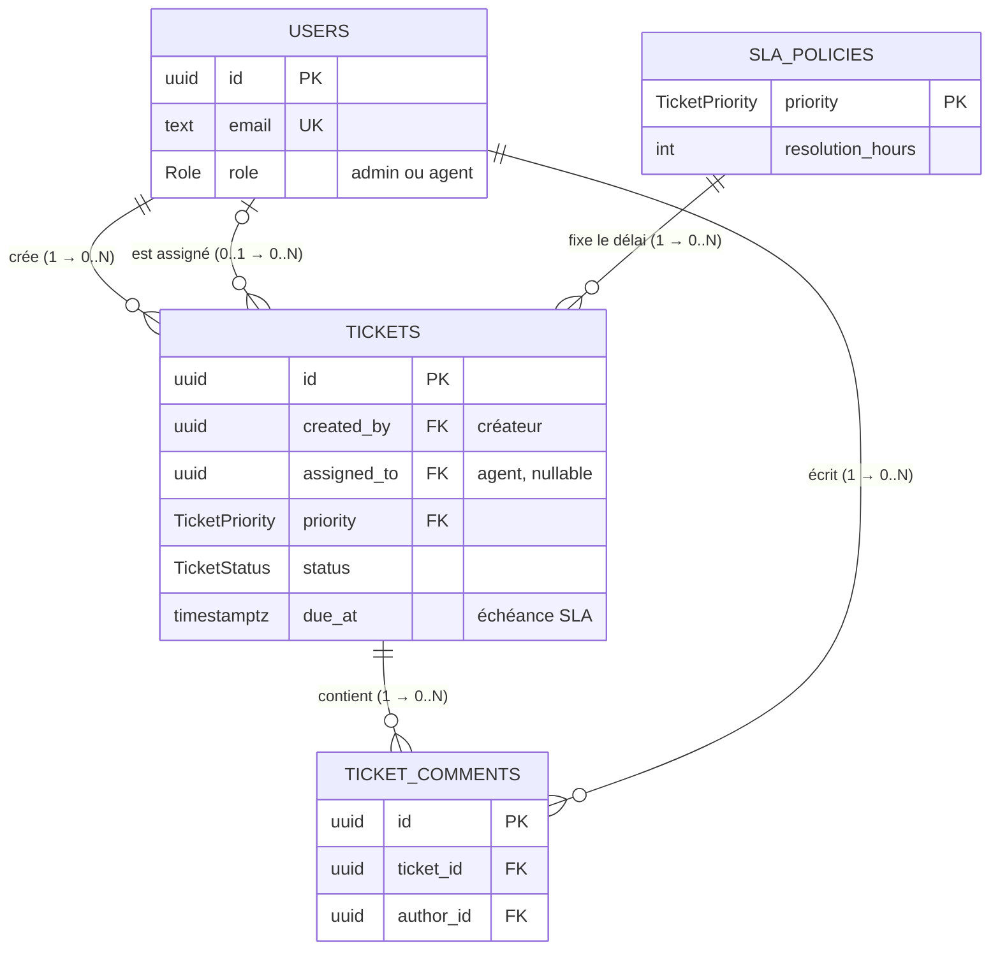
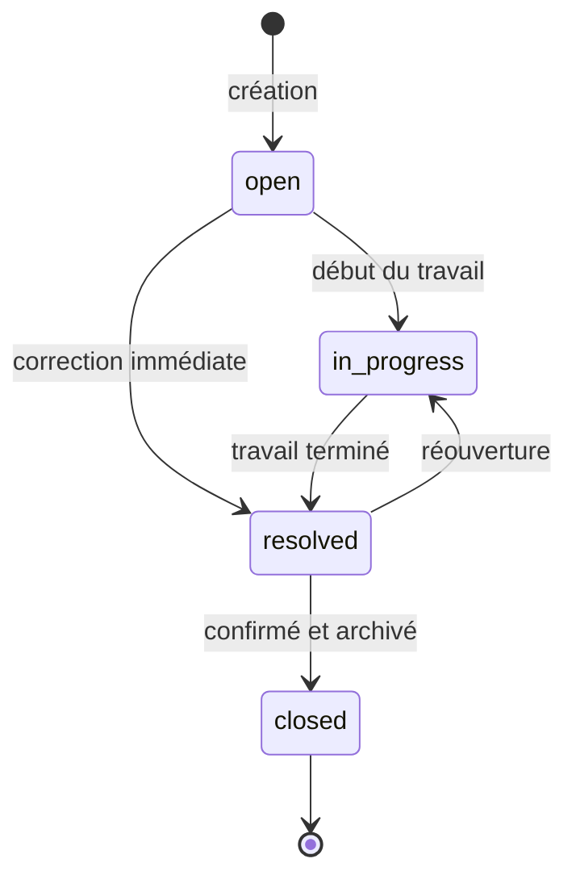

# HelpDeskPro — Document de conception

Système de tickets support avec suivi des délais de résolution (SLA). Ce document décrit le modèle de données (ERD, clés, contraintes, index) et les règles métier. Le schéma Prisma, la migration SQL et l'API implémentent exactement ce qui est décrit ici.

**En bref**

- 4 tables : `users`, `tickets`, `ticket_comments`, plus `sla_policies` (délais SLA par priorité).
- Clés UUIDv7, enums PostgreSQL, 5 clés étrangères, 9 contraintes CHECK, 11 index hors clés primaires (dont 2 index trigram pour la recherche).
- Les règles métier sont vérifiées par l'API (erreurs claires) ; les invariants sont garantis par la base (contraintes).

---

## 1. Contexte et périmètre

HelpDeskPro est un outil interne : le personnel support enregistre les demandes des clients sous forme de tickets, les répartit, les traite et suit leurs délais de résolution.

- **Deux rôles** : `admin` (répartit les tickets et supervise, ne traite pas les tickets) et `agent` (traite les tickets qui lui sont assignés).
- **Pas de compte client** : les tickets sont saisis par le personnel (admin ou agent) pour le compte des clients.
- **Stack** : PostgreSQL · Prisma 7 · Node.js / Express · React (Vite).

## 2. Glossaire

| Terme | Définition |
|---|---|
| **Créateur** (`created_by`) | Le membre du personnel (admin ou agent) qui a saisi le ticket. |
| **Agent** | Utilisateur de rôle `agent`. Seuls les agents peuvent être assignés à un ticket et figurer dans le top 5. |
| **Résolu** (`resolved`) | L'agent déclare le travail terminé. Le ticket reste actif : commentaires et réouverture restent possibles. |
| **Fermé** (`closed`) | État final et figé : aucune modification, aucun changement de statut, aucun commentaire. |
| **Modifier un ticket** | Modifier son contenu uniquement : titre, description, priorité. Le statut et l'assignation ont leurs propres routes. |
| **SLA** (*Service Level Agreement*, accord de niveau de service) | Engagement sur le délai de résolution, fixé selon la priorité et compté en heures calendaires. |
| **Échéance SLA** (`due_at`) | Date limite de résolution d'un ticket. |
| **En retard** | Ticket encore `open` ou `in_progress` après son échéance. |

## 3. Modèle de données (ERD)



Le schéma ne montre que les clés et les colonnes principales ; toutes les colonnes sont détaillées au §4. Lecture des symboles : `||` exactement un, `|o` zéro ou un, `o{` zéro ou plusieurs.

Les trois tables demandées par le sujet (`users`, `tickets`, `ticket_comments`) sont complétées par `sla_policies`, qui porte les délais SLA par priorité.

### Relations

| Relation | Cardinalité | Clé étrangère |
|---|---|---|
| Un utilisateur **crée** des tickets | 1 → 0..N : un ticket a exactement un créateur | `tickets.created_by` (obligatoire) |
| Un agent **est assigné** à des tickets | 0..1 → 0..N : un ticket a zéro ou un agent | `tickets.assigned_to` (facultative) |
| Une priorité SLA **s'applique** à des tickets | 1 → 0..N : un ticket a exactement une priorité | `tickets.priority` |
| Un ticket **contient** des commentaires | 1 → 0..N : un commentaire appartient à un seul ticket | `ticket_comments.ticket_id` |
| Un utilisateur **écrit** des commentaires | 1 → 0..N : un commentaire a un seul auteur | `ticket_comments.author_id` |

- Toutes les relations sont de type **un-à-plusieurs (1-N)** ; il n'y a aucune relation un-à-un (1-1).
- `users` et `tickets` sont reliés **deux fois**, par deux relations distinctes : le créateur et l'agent assigné.
- « Un utilisateur commente plusieurs tickets, un ticket reçoit les commentaires de plusieurs utilisateurs » est une relation **plusieurs-à-plusieurs (N-N)** : elle passe par `ticket_comments`, une table à part entière (une ligne par message, avec son texte et sa date).

### Colonnes ajoutées au minimum du sujet

Règle suivie : une colonne n'est ajoutée que si l'application a besoin d'une donnée qu'aucune autre colonne ne contient.

| Colonne | Pourquoi |
|---|---|
| `tickets.due_at` | Échéance SLA, figée à la création : si les délais changent plus tard, les tickets existants gardent l'échéance promise. |
| `tickets.resolved_at` | Savoir *quand* le ticket a été résolu (SLA respecté ou dépassé). |
| `updated_at` (`users`, `tickets`) | Date de dernière modification (timestamps cohérents). |

Colonnes écartées volontairement :

- **`resolved_by`** : un ticket terminé ne peut plus être réassigné, donc l'agent assigné *est* celui qui l'a résolu ; `assigned_to` suffit.
- **`closed_at`** : un ticket fermé ne change plus jamais, donc son `updated_at` *est* sa date de fermeture.

## 4. Tables

### 4.1 `users`

| Colonne | Type | Contraintes |
|---|---|---|
| `id` | `uuid` | PK, UUIDv7 généré par Prisma |
| `name` | `text` | NOT NULL |
| `email` | `text` | NOT NULL, UNIQUE, CHECK minuscules |
| `password_hash` | `text` | NOT NULL ; hash bcrypt, jamais renvoyé par l'API |
| `role` | enum `Role` | NOT NULL : `admin` ou `agent` |
| `created_at` | `timestamptz(3)` | NOT NULL, défaut `now()` |
| `updated_at` | `timestamptz(3)` | NOT NULL, mis à jour par Prisma |

L'API normalise l'email en minuscules : la connexion est insensible à la casse.

### 4.2 `sla_policies`

| Colonne | Type | Contraintes |
|---|---|---|
| `priority` | enum `TicketPriority` | PK : `low`, `medium`, `high` |
| `resolution_hours` | `integer` | NOT NULL, CHECK > 0 |

| Priorité | Délai de résolution |
|---|---|
| `high` | 4 h |
| `medium` | 24 h |
| `low` | 72 h |

Pourquoi une table plutôt qu'une constante dans le code : la règle SLA est visible dans le modèle de données, un délai se change par un simple `UPDATE` sans redéploiement, et `tickets.priority` la référence (aucune priorité sans délai défini).

### 4.3 `tickets`

| Colonne | Type | Contraintes |
|---|---|---|
| `id` | `uuid` | PK, UUIDv7 généré par Prisma |
| `title` | `text` | NOT NULL, CHECK non vide |
| `description` | `text` | NOT NULL, CHECK non vide |
| `priority` | enum `TicketPriority` | NOT NULL, défaut `medium`, FK → `sla_policies.priority` |
| `status` | enum `TicketStatus` | NOT NULL, défaut `open` |
| `created_by` | `uuid` | NOT NULL, FK → `users.id` |
| `assigned_to` | `uuid` | nullable, FK → `users.id` |
| `due_at` | `timestamptz(3)` | NOT NULL, CHECK postérieur à `created_at` |
| `resolved_at` | `timestamptz(3)` | renseigné si et seulement si le statut est `resolved` ou `closed` |
| `created_at` | `timestamptz(3)` | NOT NULL, défaut `now()` |
| `updated_at` | `timestamptz(3)` | NOT NULL, mis à jour par Prisma |

Correspondance avec le sujet : `createdBy` → `created_by`, `assignedTo` → `assigned_to`, `createdAt` → `created_at`. L'API expose les noms du sujet (camelCase).

### 4.4 `ticket_comments`

| Colonne | Type | Contraintes |
|---|---|---|
| `id` | `uuid` | PK, UUIDv7 généré par Prisma |
| `ticket_id` | `uuid` | NOT NULL, FK → `tickets.id` (ON DELETE CASCADE) |
| `author_id` | `uuid` | NOT NULL, FK → `users.id` |
| `message` | `text` | NOT NULL, CHECK non vide |
| `created_at` | `timestamptz(3)` | NOT NULL, défaut `now()` |

Les commentaires sont **permanents** (ni modification ni suppression) : l'historique des échanges reste fiable. D'où l'absence de `updated_at`.

## 5. Contraintes

L'API valide d'abord chaque requête (Zod et règles métier, avec des messages clairs). La base garantit les invariants en dernier recours, même en cas de bug applicatif.

### 5.1 Clés étrangères

| Colonne | Référence | ON DELETE | Pourquoi |
|---|---|---|---|
| `tickets.created_by` | `users.id` | RESTRICT | Un utilisateur lié à des tickets ne peut pas disparaître (historique). |
| `tickets.assigned_to` | `users.id` | RESTRICT | Idem ; les utilisateurs ne sont jamais supprimés. |
| `tickets.priority` | `sla_policies.priority` | RESTRICT | Impossible de supprimer un délai SLA encore utilisé. |
| `ticket_comments.ticket_id` | `tickets.id` | **CASCADE** | Supprimer un ticket saisi par erreur supprime ses commentaires. |
| `ticket_comments.author_id` | `users.id` | RESTRICT | Historique des échanges. |

### 5.2 Contraintes CHECK

`NOT NULL` n'empêche pas une chaîne vide : les CHECK « non vide » comblent ce trou. Les autres garantissent les invariants métier.

| Contrainte | Règle | Garantie |
|---|---|---|
| `users_email_lowercase_chk` | `email = lower(email)` | Unicité réelle des emails : pas de doublon `Ali@x.ma` / `ali@x.ma`. |
| `sla_policies_resolution_hours_chk` | `resolution_hours > 0` | Un délai SLA est toujours positif. |
| `tickets_title_not_blank_chk` | `btrim(title) <> ''` | Titre non vide. |
| `tickets_description_not_blank_chk` | `btrim(description) <> ''` | Description non vide. |
| `tickets_resolved_at_status_chk` | `(status IN ('resolved','closed')) = (resolved_at IS NOT NULL)` | Un ticket résolu ou fermé a toujours une date de résolution, et seulement lui. |
| `tickets_assignee_required_chk` | `status = 'open' OR assigned_to IS NOT NULL` | Seul un ticket `open` peut être sans agent : un ticket en cours, résolu ou fermé a toujours un responsable. |
| `tickets_due_after_created_chk` | `due_at > created_at` | Échéance cohérente. |
| `tickets_resolved_after_created_chk` | `resolved_at IS NULL OR resolved_at >= created_at` | Date de résolution cohérente. |
| `ticket_comments_message_not_blank_chk` | `btrim(message) <> ''` | Commentaire non vide. |

Les valeurs de `status`, `priority` et `role` sont contraintes par des **enums PostgreSQL** : une valeur inconnue (par exemple `pending`) est refusée par la base.

### 5.3 Où vit chaque contrainte

Prisma génère la migration à partir de `schema.prisma` (tables, enums, clés, `UNIQUE`, `NOT NULL`, valeurs par défaut, index), mais ne sait exprimer ni les contraintes `CHECK` ni l'extension `pg_trgm` : elles sont ajoutées à la main dans [la migration SQL](../server/prisma/migrations/20261013214935_init/migration.sql).

## 6. Index

PostgreSQL n'indexe pas automatiquement les clés étrangères : chaque clé étrangère utilisée en filtre ou en jointure a son index.

| Index | Colonnes | Type | Sert à |
|---|---|---|---|
| `users_email_key` | `email` | B-tree UNIQUE | Connexion (recherche par email) et unicité |
| `tickets_status_idx` | `status` | B-tree | Filtre `status`, compteurs du tableau de bord |
| `tickets_priority_idx` | `priority` | B-tree | Filtre `priority`, clé étrangère vers `sla_policies` |
| `tickets_assigned_to_idx` | `assigned_to` | B-tree | Filtre `assignedTo`, top 5 des agents, clé étrangère |
| `tickets_created_at_idx` | `created_at` | B-tree | Tri par date (plus récents d'abord) et pagination |
| `tickets_created_by_idx` | `created_by` | B-tree | Clé étrangère (jointure vers le créateur) |
| `tickets_due_at_idx` | `due_at` | B-tree | Tickets en retard (SLA) |
| `tickets_title_trgm_idx` | `title` | GIN trigram | Recherche « contient » sur le titre |
| `tickets_description_trgm_idx` | `description` | GIN trigram | Recherche « contient » sur la description |
| `ticket_comments_ticket_id_created_at_idx` | `ticket_id, created_at` | B-tree composite | Historique d'un ticket dans l'ordre chronologique, clé étrangère, suppression en cascade |
| `ticket_comments_author_id_idx` | `author_id` | B-tree | Clé étrangère |

### Recherche : pourquoi un index trigram

La recherche porte sur des fragments (« imprim », « 504 ») dans le titre **ou** la description : un `ILIKE '%…%'` ne peut pas utiliser un index B-tree. L'extension `pg_trgm` découpe chaque texte en groupes de 3 caractères et l'index GIN retrouve directement les tickets qui les contiennent. La recherche plein texte (`tsvector`) a été écartée : elle travaille sur des mots entiers (« 504 » ne trouve pas « ERR504 »).

### Index volontairement absents

- `users.role` : la table compte quelques lignes, un index n'apporterait rien.
- Pas d'index composite « filtre + tri » sur `tickets` : à ce volume, les index simples demandés par le sujet suffisent. Un index comme `(status, created_at)` serait l'évolution naturelle si le volume grandit.

## 7. Règles métier

Chaque règle est vérifiée en un seul endroit de l'API, qui renvoie une erreur claire. Les contraintes du §5 sont le filet de sécurité.

### 7.1 Cycle de vie d'un ticket



| Transition | Quand | Effet |
|---|---|---|
| `open` → `in_progress` | Le travail commence. | — |
| `open` → `resolved` | Correction immédiate, sans étape « en cours ». | `resolved_at` = maintenant |
| `in_progress` → `resolved` | Le travail est terminé. | `resolved_at` = maintenant |
| `resolved` → `in_progress` | Réouverture : la correction n'a pas tenu. | `resolved_at` effacé |
| `resolved` → `closed` | Confirmé et archivé (**règle du sujet**). | — |

- Toute autre transition est refusée (**409**) : passer directement à `closed`, revenir à `open` par la route de statut, sortir de `closed`. Seule la désassignation d'un ticket en cours le renvoie à `open` (§7.3).
- Quitter `open` exige un agent assigné (sinon **409**).
- `closed` est définitif : plus de modification, de changement de statut ni de commentaire.
- La vérification est atomique : la mise à jour ne s'applique que si le statut actuel autorise la transition (`UPDATE … WHERE status IN (statuts de départ autorisés)`). Deux requêtes simultanées ne peuvent pas contourner la règle.

### 7.2 Permissions

| Action | Admin | Agent |
|---|---|---|
| Voir les tickets, les commentaires, le tableau de bord | ✅ tous | ✅ tous |
| Créer un ticket | ✅ | ✅ |
| Modifier le contenu (titre, description, priorité) | ✅ tout ticket | ✅ tickets qu'il a créés ou qui lui sont assignés |
| Assigner, réassigner, désassigner | ✅ | ❌ 403 |
| Changer le statut | ✅ tout ticket | ✅ uniquement ses tickets assignés |
| Commenter | ✅ | ✅ |
| Supprimer un ticket | ✅ si `open` | ❌ 403 |

Pour tous, admin compris : un ticket fermé est figé, les transitions suivent le §7.1, un ticket terminé ne se réassigne pas.

- L'admin répartit le travail mais ne traite pas les tickets. Il peut toutefois intervenir sur n'importe quel ticket (par exemple fermer un ticket résolu dont l'agent est absent) pour qu'aucun ticket ne reste bloqué.
- Les agents voient tous les tickets : c'est ce qui donne un sens au filtre `assignedTo`.
- Les commentaires sont ouverts à tout le personnel : ce sont des informations, pas des actions. Le créateur peut transmettre un rappel du client, un collègue peut partager une solution connue.

### 7.3 Assignation

- Réservée à l'admin. La cible doit être un utilisateur de rôle `agent` (sinon **400**).
- Possible tant que le ticket est `open` ou `in_progress`. Un ticket `resolved` ou `closed` ne se réassigne pas (**409**) : il faut d'abord le rouvrir.
- Désassigner un ticket `in_progress` le renvoie à `open`, puisque plus personne ne travaille dessus (garanti par `tickets_assignee_required_chk`).

### 7.4 Commentaires

- Ajout par tout membre du personnel ; interdit si le ticket est `closed` (**409**, **règle du sujet**).
- Historique renvoyé dans l'ordre chronologique.
- Permanents : ni modification ni suppression.

### 7.5 Suppression

- Réservée à l'admin, et seulement pour un ticket `open` : la suppression sert aux erreurs de saisie et aux doublons, repérés tôt.
- Un ticket qui a été traité fait partie de l'historique : le supprimer fausserait le top 5 et effacerait son suivi SLA (**409**).
- Ses commentaires sont supprimés avec lui (`ON DELETE CASCADE`).

### 7.6 SLA

- À la création : `due_at = created_at + délai de la priorité` (lu dans `sla_policies`).
- Si la priorité change pendant que le ticket est `open` ou `in_progress`, l'échéance est recalculée depuis `created_at` avec le nouveau délai.
- Délais en heures calendaires (24 h/24, 7 j/7).
- L'état SLA est **calculé**, jamais stocké :

| État | Condition |
|---|---|
| Dans les délais | `open` ou `in_progress`, et maintenant ≤ `due_at` |
| **En retard** | `open` ou `in_progress`, et maintenant > `due_at` |
| Respecté | `resolved` ou `closed`, et `resolved_at` ≤ `due_at` |
| Dépassé | `resolved` ou `closed`, et `resolved_at` > `due_at` |

### 7.7 Tableau de bord

| Indicateur | Calcul |
|---|---|
| Total des tickets | `COUNT(*)` |
| Tickets `open` | `COUNT(*) WHERE status = 'open'` |
| Tickets `in_progress` | `COUNT(*) WHERE status = 'in_progress'` |
| Tickets en retard (SLA) | `COUNT(*) WHERE status IN ('open','in_progress') AND due_at < now()` |
| Top 5 des agents | Tickets `resolved` ou `closed` groupés par `assigned_to`, triés par nombre décroissant, limités à 5 |

Le top 5 compte aussi les tickets fermés depuis leur résolution : fermer un ticket ne fait jamais baisser le score d'un agent. Si l'admin résout ou ferme un ticket à la place de l'agent, le mérite reste à l'agent assigné.

## 8. API REST

Toutes les routes, sauf la connexion et la déconnexion, exigent une session : à la connexion, l'API pose le JWT dans un cookie httpOnly que le navigateur renvoie automatiquement (§10).

| Méthode | Route | Accès | Notes |
|---|---|---|---|
| POST | `/api/auth/login` | public | Email et mot de passe → cookie de session (JWT, 8 h) |
| POST | `/api/auth/logout` | public | Supprime le cookie de session |
| GET | `/api/auth/me` | connecté | Utilisateur courant (restaure la session au chargement du front) |
| GET | `/api/users` | connecté | `id`, `name`, `email`, `role` (assignation et filtre) ; filtre optionnel `role` |
| GET | `/api/dashboard/stats` | connecté | Indicateurs du §7.7 |
| POST | `/api/tickets` | connecté | Créé `open`, non assigné, `due_at` calculé |
| GET | `/api/tickets` | connecté | Filtres `status`, `priority`, `assignedTo`, `search` ; pagination `page`, `pageSize` |
| GET | `/api/tickets/:id` | connecté | Détail et état SLA |
| PUT | `/api/tickets/:id` | admin, ou agent créateur ou assigné | Titre, description, priorité |
| PATCH | `/api/tickets/:id/status` | admin, ou agent assigné | Transitions du §7.1 |
| PATCH | `/api/tickets/:id/assign` | admin | `assignedTo` : identifiant d'un agent, ou `null` pour désassigner |
| DELETE | `/api/tickets/:id` | admin | Seulement si `open` |
| POST | `/api/tickets/:id/comments` | connecté | Refusé si `closed` |
| GET | `/api/tickets/:id/comments` | connecté | Ordre chronologique |

La liste est triée du plus récent au plus ancien et renvoyée avec ses informations de pagination :

```json
{
  "data": [{ "id": "…", "title": "…", "status": "open" }],
  "meta": { "page": 1, "pageSize": 10, "total": 42, "totalPages": 5 }
}
```

## 9. Gestion des erreurs

Toutes les erreurs ont le même format :

```json
{ "error": { "code": "TICKET_CLOSED", "message": "Impossible de commenter un ticket fermé." } }
```

Les erreurs de validation ajoutent `details` (champ concerné et message). Les codes sont en anglais, stables pour le client ; les messages sont en français et affichés tels quels par l'interface.

| HTTP | Quand | Codes |
|---|---|---|
| 400 | Entrée invalide (validation Zod), assignation à un utilisateur qui n'est pas agent | `VALIDATION_ERROR`, `INVALID_ASSIGNEE` |
| 401 | Identifiants incorrects ; jeton absent, invalide ou expiré | `INVALID_CREDENTIALS`, `UNAUTHORIZED` |
| 403 | Le rôle ne permet pas l'action ; requête venant d'une autre origine (CSRF) | `FORBIDDEN` |
| 404 | Ticket ou utilisateur introuvable | `NOT_FOUND` |
| 409 | Requête valide, mais l'état du ticket l'interdit | `INVALID_STATUS_TRANSITION`, `TICKET_CLOSED`, `TICKET_NOT_ASSIGNED`, `TICKET_FINISHED`, `TICKET_NOT_DELETABLE`, `TICKET_MODIFIED` |
| 429 | Trop de tentatives de connexion échouées | `TOO_MANY_REQUESTS` |
| 500 | Erreur inattendue, sans trace technique renvoyée | `INTERNAL_ERROR` |

`TICKET_MODIFIED` ne sert qu'en dernier recours : le ticket a changé entre la vérification des règles et l'écriture (requête concurrente). Et 409 plutôt que 400, car la requête est correcte : c'est l'état actuel du ticket qui l'interdit.

## 10. Choix techniques

- **Prisma 7.10.0**, version épinglée : la version `latest` publiée sur npm est une release candidate de Prisma 8.
- **UUIDv7** générés par Prisma : identifiants recommandés par le sujet, ordonnés dans le temps, ce qui évite la fragmentation d'index des UUID aléatoires (v4).
- **Enums PostgreSQL** (`Role`, `TicketStatus`, `TicketPriority`) : valeurs contrôlées par la base et typées côté TypeScript.
- **`text` + CHECK** plutôt que `varchar(n)` : les longueurs maximales sont validées par l'API (Zod), la base garantit l'essentiel (non vide).
- **`timestamptz`** : horodatages avec fuseau horaire, sans ambiguïté.
- **Requêtes paramétrées uniquement** : API Prisma, ou `$queryRaw` en template ; aucun `$queryRawUnsafe`, donc pas d'injection SQL.
- **Authentification** : mots de passe hachés avec bcrypt (coût 12). JWT signé en HS256, valable 8 h, stocké dans un cookie `httpOnly` (inaccessible au JavaScript, donc à l'abri d'une faille XSS), `SameSite=Strict`, `Secure` en production. Pas de jeton de rafraîchissement : à expiration, l'utilisateur se reconnecte.
- **Protection CSRF** : en plus de `SameSite=Strict`, toute requête qui modifie des données est refusée si le navigateur indique qu'elle vient d'un autre site (en-têtes `Sec-Fetch-Site`, ou `Origin` pour les anciens navigateurs). Seuls le front (`CLIENT_URL`) et l'API elle-même (Swagger) sont acceptés.
- **Connexion** : message identique pour un email inconnu et un mauvais mot de passe, avec un temps de réponse identique (bcrypt exécuté dans les deux cas) ; 10 échecs maximum par 15 minutes et par adresse IP.
- **Durcissement HTTP** : en-têtes de sécurité (helmet), CORS limité à l'origine du front, corps JSON limité à 50 ko, variables d'environnement validées au démarrage (secret JWT d'au moins 32 caractères).
- **Pagination par page** (`page`, `pageSize`) avec total : simple et adaptée à une liste numérotée.

## 11. Données de test (seed)

- 1 admin et 2 agents (identifiants dans le README), plus les 3 délais SLA.
- 10 tickets couvrant les 4 statuts, dont des tickets en retard et des tickets résolus dans et hors délai, pour rendre le SLA et le top 5 visibles.
- 20 commentaires, tous antérieurs à la fermeture de leur ticket.
- Dates générées dans le passé ; toutes les données respectent les contraintes du §5.

## 12. Évolutions possibles

- Gestion des utilisateurs par l'admin (création d'agents, désactivation).
- SLA en heures ouvrées et SLA de première réponse.
- Historique des changements (statut, assignation) dans une table d'audit.
- Notifications (assignation, échéance proche).
- Filtre « en retard » dans la liste des tickets.
- Pagination par curseur et index composites si le volume grandit.
